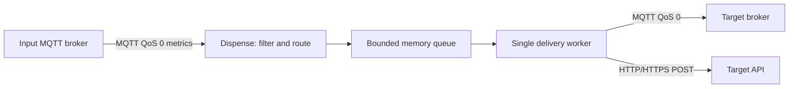

# IoT Dispense

Dispense subscribes to OT.io MQTT telemetry, filters by `sourceFilter`, and sends the original JSON to one configured output. MQTT forwarding remains the default; HTTP and HTTPS POST are also implemented.



Choose one output per instance. The MQTT input port defaults to 1883; the target port follows the broker configuration or HTTP URL. The HTTP endpoint receives the unchanged telemetry JSON with `Content-Type: application/json`, `X-OTIO-Topic: <targetPrefix>/<agentId>/metrics/<metricName>` and an `Idempotency-Key`.

## MQTT configuration

Existing JSON, environment variables and Compose services remain compatible. Omitting `output` selects MQTT with the existing `outputBroker`; the default is zero additional retries.

```json
{
  "instanceId": "iot-dispense-opcua-01",
  "sourceFilter": "opcua",
  "sourcePrefix": "iot-lense",
  "targetPrefix": "dispense/opcua",
  "bufferLimit": 1500,
  "inputBroker": {"host": "mqtt", "port": 1883, "clientId": "iot-dispense-opcua-01-in"},
  "outputBroker": {"host": "dispense-broker", "port": 1883, "clientId": "iot-dispense-opcua-01-out"}
}
```

The input and MQTT output continue to use the shared `OTIO_MQTT_USERNAME` / `OTIO_MQTT_PASSWORD` environment variables. Each instance requires unique MQTT client IDs. An empty `sourceFilter` accepts every source type.

## HTTP/HTTPS configuration

Set `output.type` to `http` for either HTTP or HTTPS. Plain HTTP is available for unauthenticated trusted-network targets. Bearer authentication requires HTTPS, a normally trusted server certificate, and a token supplied through the named environment variable. Tokens are never stored in the JSON configuration.

```json
{
  "instanceId": "iot-dispense-http-01",
  "sourceFilter": "modbus-tcp",
  "sourcePrefix": "iot-lense",
  "targetPrefix": "dispense/http",
  "bufferLimit": 1500,
  "inputBroker": {"host": "mqtt", "port": 1883, "clientId": "iot-dispense-http-01-in"},
  "output": {
    "type": "http",
    "url": "https://target.example/telemetry",
    "bearerTokenEnv": "TARGET_API_TOKEN",
    "timeoutMs": 2000
  },
  "delivery": {
    "maxRetries": 2,
    "initialBackoffMs": 200,
    "maxBackoffMs": 2000,
    "queueLimit": 128
  }
}
```

Supply `TARGET_API_TOKEN` to the process or container from your deployment's secret storage. A missing token fails startup. URL user credentials and fragments are rejected; redirects are not followed, including redirects to other HTTPS hosts. TLS verification is enabled; private certificate authorities must be installed in the container's trusted CA store. Client certificate authentication is not implemented.

For an unauthenticated local target, an environment-only example is:

```yaml
dispense-http:
  build:
    context: .
    dockerfile: apps/dispense/Dockerfile
  environment:
    DISPENSE_INPUT_BROKER_HOST: mqtt
    DISPENSE_OUTPUT_TYPE: http
    DISPENSE_HTTP_URL: http://target-api:8080/telemetry
    DISPENSE_MAX_RETRIES: 2
    DISPENSE_UI_PORT: 8200
  ports:
    - "8200:8200"
```

The target must be reachable from the Dispense container. `outputBroker` is unused when the selected output is HTTP.

## Environment variables

| Variable | Default / meaning |
|---|---|
| `DISPENSE_INSTANCE_ID` | `iot-dispense-01` |
| `DISPENSE_SOURCE_FILTER` | `modbus-tcp`; source type filter |
| `DISPENSE_SOURCE_PREFIX` | `iot-lense`; subscribed MQTT prefix |
| `DISPENSE_TARGET_PREFIX` | `dispense/out`; routed topic prefix |
| `DISPENSE_BUFFER_LIMIT` | `1500`; numeric chart points per agent/metric |
| `DISPENSE_INPUT_BROKER_HOST`, `DISPENSE_INPUT_BROKER_PORT` | `mqtt`, `1883` |
| `DISPENSE_INPUT_CLIENT_ID` | `<instanceId>-in` |
| `DISPENSE_OUTPUT_BROKER_HOST`, `DISPENSE_OUTPUT_BROKER_PORT` | `dispense-broker`, `1883` |
| `DISPENSE_OUTPUT_CLIENT_ID` | `<instanceId>-out` |
| `DISPENSE_OUTPUT_TYPE` | `mqtt`; `mqtt` or `http` |
| `DISPENSE_HTTP_URL` | HTTP/HTTPS POST endpoint |
| `DISPENSE_HTTP_TOKEN_ENV` | Name of the environment variable holding a bearer token |
| `DISPENSE_OUTPUT_TIMEOUT_MS` | `2000`; 50–30000 ms per output attempt |
| `DISPENSE_MAX_RETRIES` | `0`; 0–5 additional attempts per message |
| `DISPENSE_RETRY_BACKOFF_MS` | `200`; initial backoff |
| `DISPENSE_MAX_BACKOFF_MS` | `2000`; backoff cap, at most 30000 ms |
| `DISPENSE_QUEUE_LIMIT` | `128`; 1–10000 waiting messages |
| `DISPENSE_UI_PORT` | `8200` |
| `DISPENSE_CONFIG_JSON` | JSON overrides for these settings |

JSON can override individual fields; omitted fields retain their environment/default values. Invalid output types, deadlines, queue limits and retry bounds fail startup. Malformed JSON retains the previous complete default/environment configuration and logs a parsing error.

## Delivery, retries and duplicates

The single worker processes messages in submission order. It holds at most one active message plus `queueLimit` waiting messages. Input callbacks copy and enqueue payloads without waiting for target requests. A full/unavailable queue drops the new message. Messages over 1 MiB or invalid JSON are dropped before queueing; deliberately filtered messages have their own counter. Only numeric values enter the chart history; string, boolean and null values are still forwarded unchanged.

Each attempt has its own timeout. Retry delays double from `initialBackoffMs` up to `maxBackoffMs`. `maxRetries=2` means at most three worker attempts. Cancellation interrupts requests and backoff; shutdown cancels waiting work. A stalled or failing message delays later messages until it finishes or exhausts its budget.

| Output result | Retry rule | Meaning of success or failure |
|---|---|---|
| MQTT connection not open before publish | Retry within the configured budget | Nothing was submitted on that attempt |
| MQTT completed publish token while socket remains open | Success | Local QoS 0 handoff; broker persistence and subscriber delivery are not confirmed |
| MQTT publish error/timeout or connection closes around completion | No automatic retry | Delivery uncertain; the underlying operation may finish later |
| HTTP 2xx | Success | Target accepted the POST; downstream processing is not confirmed |
| HTTP 408, 429 or 5xx | Retry within budget | Target rejected that attempt; receivers should still deduplicate retries |
| HTTP transport failure/timeout | Retry within budget; mark uncertain | Server may already have processed the request |
| HTTP redirects or other non-2xx statuses | No retry | Terminal rejection, including 401/403 authentication failures |

HTTP retries carry the same random `Idempotency-Key` and identical JSON. A receiver must implement durable deduplication on that key if duplicates are unacceptable; the header alone does not provide exactly-once behavior. Separate incoming messages have separate keys, even if their payloads match. Configured HTTP retries can therefore duplicate writes after an ambiguous timeout or error. There is no durable outbox, replay after restart, or guaranteed delivery. MQTT remains QoS 0.

`DISPENSE_BUFFER_LIMIT` bounds chart history, not forwarding. The delivery queue, attempts and counters are process-local and disappear on restart. Dispense remains outside the HA example.

## Status and secrets

`GET /api/status` adds an `output` snapshot with `type`, `url`, `host`, `port`, `connected` and `lastOutput`. The same snapshot remains available as `outputBroker` for older clients. MQTT `connected` requires an actually open socket; it is false during reconnect. HTTP `connected` records whether the most recent completed POST returned 2xx; it is false until the first successful POST, and is not an independent availability probe.

Counters are available under `stats`:

- `received`: input messages observed, including invalid and filtered messages.
- `forwarded`: messages accepted at the output boundary described above.
- `dropped`: messages whose forwarding failed or could not be queued.
- `filtered`: valid messages excluded by `sourceFilter`.
- `pending`: waiting and currently processed messages.
- `retries`: additional worker attempts actually started.
- `uncertain`: messages with at least one ambiguous attempt, whether eventually forwarded or dropped.

At a stable snapshot, `received = forwarded + dropped + filtered + pending`. During the short input-processing stage, an observed message may not yet have been assigned to its final category. `uncertain` overlaps the final outcome; it must not be added to `dropped` or `forwarded`.

Status/runtime API responses strip the HTTP URL query string. The configuration view therefore omits those query parameters; use the deployment configuration as the source of truth. Logs never include bearer tokens, target URL query strings, rejected server response bodies or request bodies. Live Messages deliberately shows telemetry payloads. The UI configuration page prepares drafts; apply changes by restarting the process with updated deployment configuration.

## Adding another output

Add an implementation of `outputWriter` in `apps/dispense`, extend output validation and construction, and reuse the existing routing, queue, retry worker and status APIs. No separate forked application is necessary.

```go
type outputWriter interface {
    Write(context.Context, outputMessage) error
    Ready() bool
    Close()
}
```

`Write` must honor the context deadline. Return a `deliveryError` to classify retryable and ambiguous failures; unclassified errors are terminal. Define the target's acceptance boundary explicitly and keep credentials out of status/configuration objects. Kafka, NATS, database sinks and cloud-specific writers remain extension ideas.

## Tests

```sh
go test ./apps/dispense/... ./shared/mqttx/...
go vet ./apps/dispense/... ./shared/mqttx/...
```

Tests use real local HTTP/HTTPS servers and a small MQTT wire fixture with the actual Paho client. They exercise status-based retries, stable retry IDs, token use and certificate trust, request timeout, cancellation, queue saturation, broker disconnect/reconnect and conservative delivery accounting. They require no Docker daemon. The wire fixture checks client/transport behavior; it does not replace interoperability tests against deployed brokers or target APIs.
